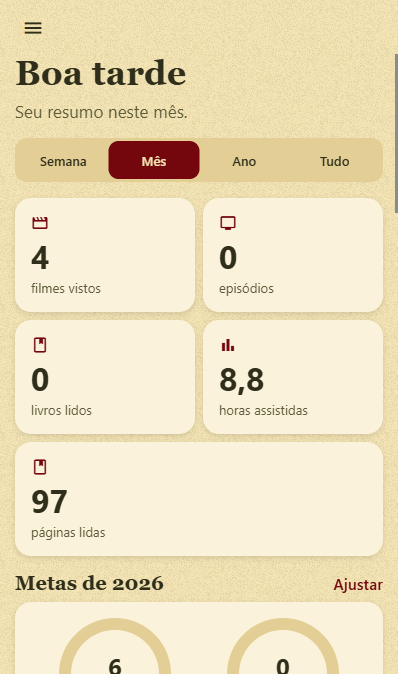
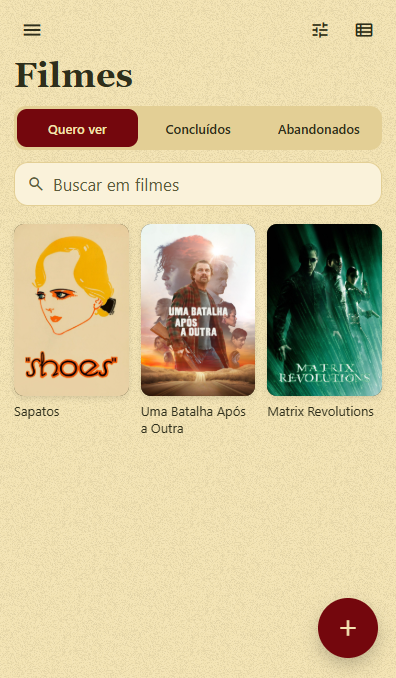
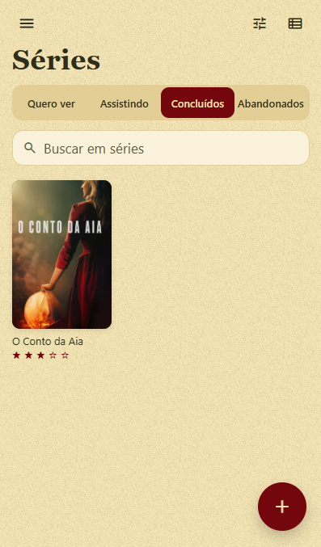

# Estante · App de livros, filmes e séries

App para **organizar livros, filmes e séries**: o que você quer ver ou ler, o que está acompanhando e o que já terminou, com notas, resenhas, metas anuais e estatísticas. Funciona **offline** e **sincroniza entre aparelhos**.

> 🔒 **Este repositório é uma vitrine.** O app é de uso pessoal e privado; o código-fonte fica num repositório privado. **Acesso ao código sob pedido.**
>
> 👩‍💼 **Recrutador(a)?** A arquitetura e os problemas resolvidos estão em **[DESTAQUES-TECNICOS.md](DESTAQUES-TECNICOS.md)**.

---

## Telas

> Prints feitos no modo de demonstração, com dados de exemplo.

| Início | Biblioteca | Ficha do item | Retrospectiva |
|---|---|---|---|
|  |  |  |  |

---

## Funcionalidades

- **Biblioteca** separada em livros, filmes e séries, com abas por status (quero ver/ler, em andamento, concluído, abandonado), grade ou lista, busca, filtros e ordenação
- **Gestos:** deslizar para avaliar, mover ou excluir (com "Desfazer"), tocar e segurar para o menu rápido, arrastar para reordenar a fila
- **Ficha detalhada:** página atual do livro, episódios e temporadas com checkbox, nota, resenha, datas, tags, com quem e onde. Dá para compartilhar a ficha como imagem
- **Painel de estatísticas:** metas anuais em anéis, concluídos por mês, gêneros, páginas por semana e sequência de dias de leitura
- **Retrospectiva do ano** em formato de stories, exportável como imagem
- **Listas personalizadas** com capa em mosaico
- **Conta e sincronização** entre aparelhos (cadastro só por convite)
- **Bloqueio com Face ID**, lembrete diário de leitura, tema claro e escuro
- **Backup:** exportar e importar em JSON e CSV (compatível com o Excel em português)

---

## Tecnologias

| Camada | Tecnologias |
|---|---|
| **App** | React Native · Expo (SDK 58) · Expo Router · TypeScript · React 19 com React Compiler |
| **Dados no aparelho** | SQLite (`expo-sqlite`) com migrações versionadas |
| **Contas e sincronização** | Supabase (Auth + Postgres com Row Level Security) |
| **Gráficos** | componentes próprios em `react-native-svg` |
| **Qualidade** | Jest · ESLint · TypeScript (`tsc`) |
| **Build e deploy** | EAS Build (iPhone sem Mac) · Cloudflare (versão web) |

Desenvolvido com apoio do **Claude Code**. Eu defini o produto, as regras e a arquitetura, testei no aparelho e tomei as decisões de projeto, que estão registradas no próprio repositório.
